<!-- ========================================= -->
<!-- RISHI BISWAS | GITHUB PROFILE README       -->
<!-- ========================================= -->

<!-- ADAPTIVE PROFILE BANNER -->
<picture>
  <source
    media="(prefers-color-scheme: dark)"
    srcset="https://raw.githubusercontent.com/Rexbiswas/Rexbiswas/main/dark.svg"
  >
  <source
    media="(prefers-color-scheme: light)"
    srcset="https://raw.githubusercontent.com/Rexbiswas/Rexbiswas/main/light.svg"
  >
  
</picture>

<!-- INTRODUCTION -->
<h1 align="center">Hi, I'm Rishi Biswas</h1>

<h3 align="center">
  Full-Stack Developer | Creative Developer | 3D Web Enthusiast
</h3>

<p align="center">
  
</p>

<!-- PROFILE ACTIONS -->
<p align="center">
  <a href="https://portfolio-nu-ivory-6osvaih25l.vercel.app/">
    
  </a>

  <a href="https://portfolio-nu-ivory-6osvaih25l.vercel.app/">
    
  </a>

  <a href="https://www.linkedin.com/in/rishi-biswas-0474a6258/">
    
  </a>
</p>

---

<!-- ABOUT ME -->
<h2>
  
</h2>

```javascript
const rishi = {
  name: "Rishi Biswas",
  role: "Full-Stack Developer",
  location: "India",
  education: "Economics Honours",
  interests: [
    "Full-Stack Development",
    "Creative UI/UX",
    "3D Web Development",
    "Interactive Experiences"
  ],
  mindset: "Building | Learning | Shipping"
};
```

- Building modern, responsive and scalable web applications.
- Passionate about creative UI/UX and interactive web experiences.
- Exploring Three.js, WebGL and immersive 3D development.
- Interested in backend architecture and real-time applications.
- Focused on clean code, performance and user experience.
- Always learning and turning ideas into digital products.

---

<!-- TECH STACK -->
<h2>
  
</h2>

<h3>Frontend Development</h3>

<p>
  
</p>

<h3>Backend Development</h3>

<p>
  
</p>

<h3>Databases</h3>

<p>
  
</p>

<h3>3D Development & Animation</h3>

<p>
  
</p>

<h3>Tools & Platforms</h3>

<p>
  
</p>

---

<!-- GITHUB STATISTICS -->
<h2>
  
</h2>

<p align="center">
  
  
</p>

<p align="center">
  
</p>

---

<!-- CONTRIBUTION SNAKE -->
<h2>
  
</h2>

<p align="center">
  <b>Watch my GitHub contributions come alive!</b>
</p>

<picture>
  <source
    media="(prefers-color-scheme: dark)"
    srcset="https://raw.githubusercontent.com/Rexbiswas/github-contribution-snake/output/github-snake-dark.svg"
  >
  <source
    media="(prefers-color-scheme: light)"
    srcset="https://raw.githubusercontent.com/Rexbiswas/github-contribution-snake/output/github-snake.svg"
  >
  
</picture>

<p align="center">
  <i>Every contribution is another step forward.</i>
</p>

---

<!-- CONTRIBUTION GRAPH -->
<h2>
  
</h2>

<p align="center">
  
</p>

---

<!-- FEATURED PROJECTS -->
<h2>
  
</h2>

<p align="center">
  <a href="https://digitaltimes.vercel.app/">
    
  </a>

  <a href="https://coralcookies.vercel.app/">
    
  </a>

  <a href="https://cryptora-smoky.vercel.app/">
    
  </a>

  <a href="https://noodle-artistary.vercel.app/">
    
  </a>
</p>

<p align="center">
  <a href="https://portfolio-nu-ivory-6osvaih25l.vercel.app/">
    <b>Explore More Projects →</b>
  </a>
</p>

---

<!-- CONNECT -->
<h2>
  
</h2>

<p align="center">
  <a href="https://www.linkedin.com/in/rishi-biswas-0474a6258/">
    
  </a>

  <a href="https://portfolio-nu-ivory-6osvaih25l.vercel.app/">
    
  </a>

  <a href="mailto:rexbiswas1@gmail.com">
    
  </a>
</p>

---

<!-- FOOTER -->
<p align="center">
  <b>BUILDING | LEARNING | SHIPPING</b>
  <br>
  <i>Turning ideas into digital experiences.</i>
</p>

<p align="center">
  
</p>
